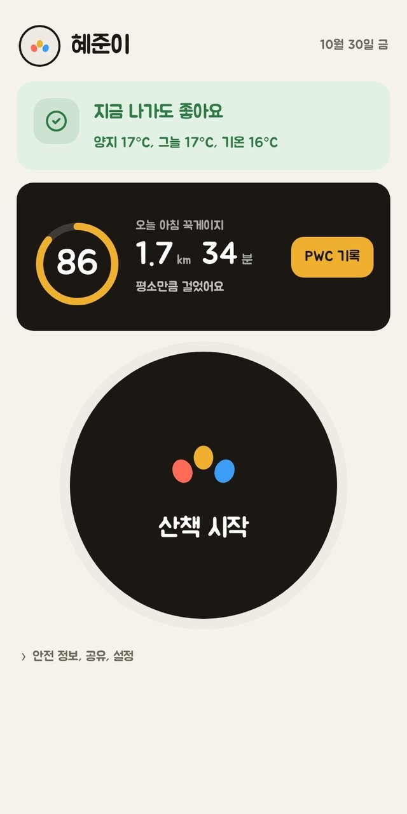

### 시영욱 / Si Yeongwook

10년 동안 오프라인 커뮤니티를 운영했습니다. 
지금은 AI 코딩 에이전트와 함께 제품을 직접 만들어 배포합니다.

I ran offline communities for ten years. Now I build and ship products myself with AI coding agents.

**지금 만드는 것 / Now building** 
반려견 산책 앱 [꾹꾹이(PADD)](https://github.com/062-SIBI/kkukkkukkkuk) 
오늘 산책은 충분했을까? Was today's walk enough?

[포트폴리오 / Portfolio](https://062-sibi.github.io/) &nbsp;|&nbsp; [꾹꾹이 써 보기 / Try PADD](https://062-sibi.github.io/kkukkkukkkuk/) &nbsp;|&nbsp; [Poopy 하기 / Play Poopy](https://poopygame.com) &nbsp;|&nbsp; [메일 / Email](mailto:siyeongook@gmail.com)

 

---

| 기간 | 한 일 | In English |
|---|---|---|
| 2015~ | 커뮤니티 운영: 부산 작업실 파티, 오프라인 살롱 '거실;', 4FL | Community building and offline events |
| 2023~2026 | 코리너스글로벌: 미디어팀 PM, 해외PM팀 팀장, 사업개발팀 매니저 | Korea-Japan marketing agency, from PM to business development |
| 2026~ | 제품 제작: 꾹꾹이(앱스토어 출시), Poopy, 모임 로테이션 도구, 유튜브 채널 호꾹이 | Building products with AI: PADD (on the App Store), Poopy, a meetup rotation tool, a YouTube channel |

일은 AI 비서 [시온](https://github.com/062-SIBI/sion-ai-workflow)과 함께 합니다. 제가 고쳐 준 내용을 기록해 다음 일에 적용합니다. 
I work with Sion, my AI assistant that logs every correction and applies it next time.

일하며 쓰던 한국어 업무 스킬은 [korean-work-skills](https://github.com/062-SIBI/korean-work-skills)로 공개했습니다. 
My Claude skills for working in Korean are open in [korean-work-skills](https://github.com/062-SIBI/korean-work-skills).

요즘은 AI가 감정을 다루는 방식을 [공부하고 있습니다](https://github.com/062-SIBI/ai-study-log). 
Currently [studying](https://github.com/062-SIBI/ai-study-log) how AI handles emotion.
